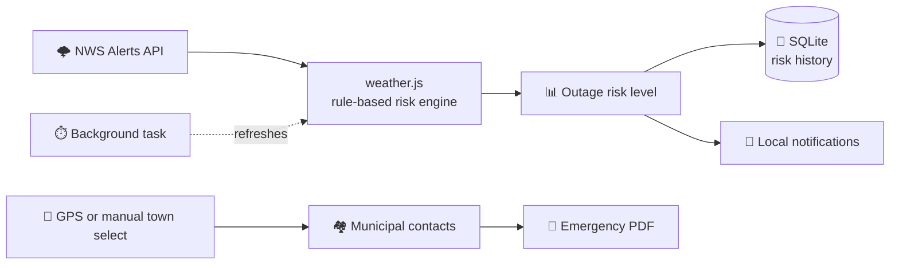

<div align="center">


# GridShield NJ

### Proactive power outage preparedness for New Jersey communities

Live weather alerts &nbsp;·&nbsp; Outage risk assessments &nbsp;·&nbsp; Local emergency resources &nbsp;·&nbsp; Offline-ready

<br />


<br />

[Features](#-features) &nbsp;•&nbsp;
[How it works](#-how-it-works) &nbsp;•&nbsp;
[Getting started](#-getting-started) &nbsp;•&nbsp;
[Roadmap](#-roadmap) &nbsp;•&nbsp;
[Contributing](#-contributing)

</div>

<br />

> [!IMPORTANT]
> **GridShield NJ is a preparedness tool, not an official emergency alert system.** Risk assessments are estimates, and the accuracy or availability of individual resources may change. Always follow instructions from official emergency management authorities, and call **911** in an emergency.

## 🌩️ About

GridShield NJ is a mobile app that helps New Jersey residents get ready for power outages and severe weather. It brings live weather alerts, location-aware emergency resources, outage risk assessments, and offline-accessible information into one place, so the important stuff is easy to find when everyday life gets disrupted.

The project is built around community resilience: making it simple to know what's coming, who to call, and where to go.

## ✨ Features

| | Feature | What it does |
|:-:|---|---|
| ⚡ | **Weather alerts & outage risk** | Pulls active alerts from the National Weather Service and turns them into a rule-based outage risk assessment, with a locally stored risk history. |
| 🔔 | **Background checks & notifications** | Runs background tasks and sends local notifications when relevant risk changes. |
| 📍 | **Local emergency resources** | Location-aware utility and emergency contacts for all **39 municipalities in Morris County**, with one-tap calling and messaging. |
| 🏘️ | **Manual town select** | Pick any municipality yourself when GPS is unavailable, or to look up somewhere else. |
| 🩺 | **Medical emergency triage** | A guided screen to help users think through emergency-related decisions. |
| ❄️ | **Cooling & warming centers** | A map-based directory of selected centers, with directions through your mapping app. |
| 🌳 | **Tree removal directory** | Companies that can help after storms. |
| 🚧 | **Road conditions** | Live incident and closure info from the official 511NJ website. |
| 📄 | **Emergency contact PDF** | Generate and share a PDF with utility and emergency contacts, tree removal contacts, a power outage checklist, and food safety guidance for refrigerated and frozen food. |
| 💾 | **Offline-first storage** | SQLite keeps contacts and risk history on the device so they're still there without a connection. |

> [!NOTE]
> Offline storage doesn't mean everything works offline. Live weather alerts, road conditions, and other online resources need a connection.

> [!WARNING]
> The medical triage feature is informational only. It does not replace professional medical advice, emergency dispatchers, or emergency services.

<!--
## 📱 Screenshots

Add screenshots to an `assets/screenshots/` folder and uncomment this block:

<div align="center">
  
  
  
  
</div>
-->

## 🧭 How it works



Risk levels come from a custom **rules-based calculation** on active NWS alert data. There's no machine learning and no API key required.

## 🛠️ Tech stack

| Layer | Tools |
|---|---|
| **Framework** | React Native 0.81 · React 19 · Expo SDK 54 · Expo Dev Client |
| **Navigation** | React Navigation (native stack) |
| **Storage** | Expo SQLite |
| **Location & notifications** | Expo Location · Expo Notifications |
| **Background work** | Expo Background Task · Expo Task Manager |
| **PDF & sharing** | Expo Print · Expo File System · Expo Sharing |
| **Maps & web content** | React Native Maps · React Native WebView |
| **Data** | National Weather Service public API (no key needed) |

## 🚀 Getting started

For developers who want to inspect, modify, or run the project locally.

**Prerequisites**

- Git, Node.js and npm
- **macOS + Xcode** for local iOS builds
- **Android Studio + Android SDK** for local Android builds
- A physical device or simulator/emulator

> [!CAUTION]
> GridShield NJ uses native modules and a custom Expo development client. **Expo Go is not supported** for the current configuration.

**1. Clone the repo**

```bash
git clone https://github.com/alexkothari/GridShield-NJ.git
cd GridShield-NJ
```

**2. Install dependencies**

```bash
npm install
```

**3. Build and launch a native app**

```bash
npm run ios       # iOS (macOS + Xcode required)
npm run android   # Android (Android Studio required)
```

**4. Start the development server**

```bash
npx expo start --dev-client
```

If the native app hasn't been built and installed yet, complete step 3 first. On a physical device you may need to scan the QR code or enter the dev server address manually, depending on your network.

## 🔌 Data sources & connectivity

| Source | Used for | Notes |
|---|---|---|
| [NWS Alerts API](https://api.weather.gov/alerts/active) | Active weather alerts | Needs network access. No API key required. |
| [511NJ](https://511nj.org/) | Road incidents and closures | Embedded page. You may need to select Morris County manually. |
| Device location | Finding your municipality | Optional. You can choose a town manually if access is denied. |
| On-device SQLite | Contacts and risk history | Available offline. |

## 🗂️ Project structure

<details>
<summary><b>Click to expand</b></summary>

<br />

```text
GridShield-NJ/
├── App.js                      # Entry point and navigation
│
├── Screens
│   ├── DirectoryScreen.js      # Main screen: risk info, contacts, resources
│   ├── RiskDetailScreen.js     # Explains the risk assessment
│   ├── CheckLogScreen.js       # Risk and check history
│   ├── TriageScreen.js         # Medical triage
│   ├── ShelterScreen.js        # Cooling and warming center map
│   ├── TreeCompanyScreen.js    # Tree removal directory
│   ├── RoadClosureScreen.js    # Embedded road conditions
│   ├── TownSelectScreen.js     # Manual municipality selection
│   └── PdfViewScreen.js        # Emergency PDF viewer
│
├── Logic & data
│   ├── weather.js              # Alert retrieval and risk calculation
│   ├── database.js             # SQLite setup and local data
│   ├── location.js             # Location and municipality handling
│   ├── municipalUtilities.js   # Municipal utility info
│   ├── notifications.js        # Local notifications
│   ├── backgroundTask.js       # Background task registration
│   ├── pdfExport.js            # Emergency PDF generation
│   ├── shelters.js             # Shelter data
│   └── treeCompanies.js        # Tree removal company data
│
├── styles.js                   # Shared styling
├── app.json                    # Expo configuration
├── package.json                # Dependencies and scripts
├── android/  ios/              # Native project files
└── assets/                     # Icons and images
```

</details>

## ⚠️ Current limitations

GridShield NJ is under active development.

- The interface and overall experience may still change.
- Production builds and public mobile distribution need additional setup.
- Resource information can go out of date, so verify it independently.

Please don't treat the app as your only source of information in an emergency.

## 🗺️ Roadmap

Planned work, not commitments to specific dates:

- [ ] Expand verified shelter information across New Jersey
- [ ] Grow the tree removal directory
- [ ] Improve the interface and accessibility
- [ ] Refine branding and app metadata
- [ ] Set up production build and distribution workflows
- [ ] Broader testing, with possible app-store distribution

## 🤝 Contributing

Suggestions, bug reports, and contributions are welcome.

1. **Fork** the repository
2. **Create a branch** for your work
3. **Make and test** your changes
4. **Commit** with a descriptive message
5. **Push** your branch and open a **pull request**

When reporting a bug, include your device or simulator, the steps to reproduce it, and any error messages you can share safely. Please keep private information, credentials, API secrets, and sensitive location data out of issues and pull requests.

## 📜 License

A license has not been chosen yet. Until one is added to the repository, please don't assume the code is available for unrestricted reuse, modification, or redistribution.

<br />

<div align="center">

**Built for New Jersey communities.** Questions, ideas, or bugs? [Open an issue](https://github.com/alexkothari/GridShield-NJ/issues).

</div>
